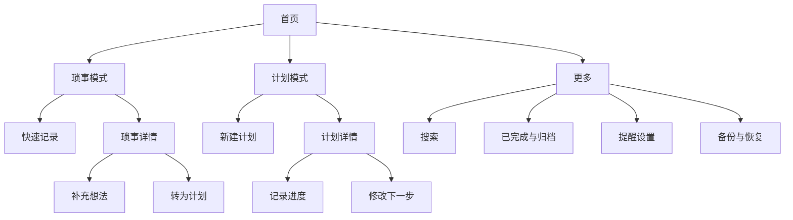

# 产品与交互设计

版本 0.2，更新：2026-10-15。范围：免费 Apple ID 自签名的个人 iPhone 本地试用版，对应本地界面源码已实现，视觉与交互仍待模拟器及真机验收。功能状态见[功能列表索引](功能列表/功能列表_索引.md)。

## 1. 统一术语与信息结构

| 概念 | 产品含义 |
|---|---|
| 事项 | 琐事与计划的共同载体 |
| 琐事 | 可以只有一个念头，不要求期限、步骤或完成标准 |
| 计划 | 有明确截止日期，能够逐步推进的事项 |
| 补充 | 给琐事添加想法、上下文或文字链接 |
| 进度 | 已经发生的一次推进；不是未来愿望 |
| 下一步 | 下次可以直接开始的一个动作 |
| 检查项 | 用户自行拆出的步骤；勾选完成不自动结束整个计划 |
| 归档 | 暂时不再考虑，仍可找回；不等于完成 |



## 2. 首页线框与操作层级

```text
琐事模式                              计划模式
┌──────────────────────┐             ┌──────────────────────┐
│ 哦对了             ···│             │ 哦对了             ···│
│   [ ● 琐事 | 计划 ]   │             │   [ 琐事 | 计划 ● ]   │
│                      │             │                      │
│ 留住一个，还没想完的念头 │             │ 先往前走一小步          │
│                      │             │ ── 近期截止 ───────── │
│ ╭──────────────────╮ │             │ ┌──────────────────┐ │
│ │ 想把阳台弄舒服一点  │ │             │ │ 10.30  交材料      │ │
│ │ 后来想到：先换个灯  │ │             │ │ 下一步：找去年版本  │ │
│ ╰──────────────────╯ │             │ │ 已完成 2 / 5 步     │ │
│ ╭──────────────────╮ │             │ └──────────────────┘ │
│ │ 找个周末看看海      │ │             │ 最近进展：收齐两份证明 │
│ ╰──────────────────╯ │             │                      │
│      我现在有空       │             │                      │
│    [ ＋ 记一下 ]      │             │    [ ＋ 新计划 ]      │
└──────────────────────┘             └──────────────────────┘
```

全局固定可见控件：分段开关、更多菜单、主按钮。琐事页额外显示一个低强调度的“我现在有空”文字入口。卡片本身可点，首页不堆叠“编辑、删除、暂停、分享”等小按钮。

分段开关支持点击与拖动滑块；不依赖整页左右滑动，避免与系统返回和列表手势冲突。切换保留各自滚动位置和未提交草稿。键盘出现时主按钮随安全区域调整。

## 3. 琐事记录与逐步完善

1. 点“记一下”，底部编辑页弹出，光标直接进入文字框。
2. 只填一句也可保存，不要求分类、标题、期限或标签；首个非空行作为标题，余下文字作为正文。
3. 保存后回到当前模式，新卡片短暂强调。输入过程持久化草稿，失败时保留原文与重试入口。
4. 详情首屏展示原始念头、最新补充与“又想到一点”。历史按时间展开，原文编辑可查看上一个版本。
5. “先放一放”可暂停该事项提醒 7 天；另有长期关闭提醒开关。到期是否恢复仍取决于排程窗口，不承诺后台即时执行代码。
6. “做到了”显式完成，可撤销；“不打算做了”进入归档，不记作完成。
7. “转为计划”只要求补截止日期，可顺便写下一步；原地保留编号和全部时间线。

“我现在有空”提供 5 / 15 / 30 分钟筛选，时间估计为可选字段；未标注时间的琐事仍可出现。一次展示一条，支持“看看这个”“换一个”。这是用户主动浏览，不发送系统通知，也不改变随机提醒设置。

输入建议上限：标题 120 个字符，正文与每条补充 20,000 个字符；超限保留草稿并说明，绝不静默截断。链接按普通文本保存，可点击打开。

## 4. 计划建立与推进

创建必填：一句描述、截止日期。默认“当天结束”，可切换到具体时间。下一步和检查项可跳过，保存后以轻提示邀请补充。

计划详情的主操作是“记进度”；次操作是“编辑下一步”。完成、暂停、改期、归档收在清晰的状态区域或更多菜单。避免每次记录进展都要填百分比。

- 下一步例：“打开文档，列出三段标题”。推荐小到 5–15 分钟可以开始，但不强制估时。
- 进度例：“读完第 2 节，卡在图 3 的推导”。时间自动记录，可修改误记内容。
- 有检查项：显示“完成 2 / 5 步”，明确它是步骤计数；没有检查项：显示最近进展，不虚构百分比。
- 所有检查项勾完：建议“这件事完成了吗”，由用户确认后完成事项。
- 改截止日期：记录原日期与新日期；重排后续提醒。
- 已逾期：显示“已过期 2 天”，提供“继续做 / 改期 / 归档”；不每天升级警报或惩罚。
- 暂停计划：移出进行中摘要和独立截止提醒，界面同时说明“暂停期间不提醒”；恢复后重新排程。

首页排序：逾期 → 今日 → 未来七天 → 以后；分组内按截止时间，时间相同按最近更新。完成和归档内容不占首页，可从更多菜单查找。

## 5. 状态与资料操作

| 操作 | 结果 | 提醒处理 |
|---|---|---|
| 完成 | 保留内容与完成时间 | 取消对应未来通知，更新摘要 |
| 取消完成 | 回到完成前活动状态 | 从当前时间重新计算，不补发过去通知 |
| 归档 | 保留内容但退出活动列表 | 取消对应未来通知 |
| 删除 | 进入回收站，30 天内可恢复 | 取消未来通知；清理已展示的相关通知 |
| 恢复 | 回到删除前状态 | 重新校验期限与提醒设置 |
| 永久删除 | 用户在回收站明确操作后删除 | 撤销所有相关通知和本地附件引用（首版无附件） |

30 天过期清理在下次 App 有执行机会时发生，不能把后台自动清理说成保证。搜索覆盖标题、正文、补充与进度；默认搜索活动事项，可切换已完成和归档。

## 6. 提醒设置与通知交互

设置顺序：提醒方式 → 总开关 → 时间规则 → 每日免打扰区间（仅避开规则显示）→ 琐事频率 → 计划摘要时间 → 通知内容隐私。

提醒方式默认“本地”，按本机规则随机洗牌生成候选并安排通知。另预留“云端”，标注“尚未接入”并禁用其操作；接入完成后才可切换，并可切回本地。这与首页琐事/计划开关、免打扰/全天随机选项分别独立。

每次启动或回到前台补齐含今天的 3 个自然日；设置页显示已安排到的日期。用户已接受启动补排，不弹出维护性质的续排催促。随机排序作用于提醒候选与主动抽取，不反复打乱已经浏览的卡片。

- 默认建议：避开 23:00–09:00；每天至多 1 条琐事提醒；每日 20:30 摘要。首次启用前可修改。
- 免打扰区间支持跨午夜与多个区间。全天随机时忽略这些区间，说明“任何时刻都可能提醒，包括夜间”。系统专注模式仍生效。
- 避开模式下，摘要时间落入免打扰区间时可改到区间外或关闭摘要；独立期限提醒给出更早的允许时间供确认，不悄悄推到截止之后。
- 默认通知显示事项标题与简短摘要，让用户直接看到内容；遵循 iOS 锁屏预览设置。用户也可在 App 内关闭内容预览，改用通用文案。App 内摘要始终显示完整内容。
- 琐事通知：“哦对了，你之前记下了一个念头。”开启内容预览后可显示具体标题。
- 计划通知：“哦对了，看看今天的计划。”内容预览开启后示例：“2 项临近截止。交材料：先找去年版本。”
- 点通知正文直接打开对应详情或当天摘要；操作按钮首版只保留“稍后提醒”和“打开”。完成在详情内操作，避免误触锁屏。
- 稍后提醒默认 1 小时；避开模式若进入免打扰，则推到下一个允许区间，界面可查看实际时间。一天至多 2 次用户触发的稍后提醒，超过时引导在 App 内调整。

通知首次授权放在第一次启用提醒时；拒绝后记录功能仍完整可用，设置页解释如何重新开启。系统不会因反复调用授权接口再次弹出首次授权框。[Apple 通知授权](https://developer.apple.com/documentation/usernotifications/asking-permission-to-use-notifications)。

## 7. 视觉设计参数

| 项目 | 共用基础 | 琐事 | 计划 |
|---|---|---|---|
| 背景 | 浅色 `#F7F6F2`；深色 `#151719` | 柔和低饱和渐变 | 近纯色，少量分区底色 |
| 正文 | 浅色 `#202427`；深色 `#F2F2EF` | 不将文字直接压在高变化渐变上 | 同左 |
| 强调色 | 同屏一种主强调色 | 深青 `#17665F`；装饰淡青 `#CDE8DF`、浅紫 `#E3DDF5` | 朱红 `#B93829`，搭配深灰线条 |
| 字体 | 系统中文与系统数字字体，正文默认 17 pt | 标题较轻，行距舒展 | 标题较重，日期对齐 |
| 卡片 | 内边距 16–20 pt | 圆角 24–28 pt，不规则背景限装饰层 | 圆角 4–8 pt，1 pt 分隔线 |
| 布局 | 页面边距 20 pt；8 pt 间距基准 | 纵向卡片、留白较多 | 网格对齐、紧凑有序 |
| 主按钮 | 高 52–56 pt，文本加图标 | 胶囊 | 小圆角矩形 |
| 动效 | 180–280 ms 的短切换 | 低幅形状变化，仅前台运行 | 干净的位移与透明度变化 |

色值为设计起点；实现必须验证深浅色对比度，普通正文至少 4.5:1，不能因坚持色值牺牲可读性。重要状态同时用文字或图形表达。

## 8. 无障碍与性能

- 最小可点区域 44 × 44 pt；按钮有 VoiceOver 标签和明确选中态。
- 支持动态字体，最大辅助字号改为单列；正文不因布局被截断，首页只限制预览行数。
- “减少动态效果”开启时，液体装饰静态化；低电量和后台暂停所有装饰动画。
- 不隐藏系统返回方式，不把长按或滑动作为唯一操作入口。
- 减少透明度时使用实色背景；深色模式单独检查，不能只对颜色反相。

## 9. 必须设计的状态

| 状态 | 用户看到的内容 |
|---|---|
| 首次空白 | “先记下一句，没想完整也可以。”和主按钮 |
| 琐事全部休眠 | “这些念头先放着。想起来时再补一句。” |
| 无计划 | “有了期限，再把它放到这里。” |
| 无通知权限 | 非阻塞提示与系统设置入口 |
| 保存失败 | 原文与草稿保留，提供重试，不假装保存成功 |
| 排程失败或覆盖用尽 | 设置页显示原因、实际覆盖时间；打开后补排未来 3 个自然日 |
| 云端未接入 | 本地正常可用，云端选项标注未接入，不假装切换成功 |
| 摘要对应事项已完成或删除 | 打开时刷新数据，显示最新状态，允许返回首页 |
| 数据恢复中 | 显示进度，暂时禁止写入；失败回到恢复前资料 |

首版不显示连续打卡天数、失败评分、红点任务总数或无意义庆祝动画。完成反馈是一句“这件事，做到了”和可关闭的轻触感。
