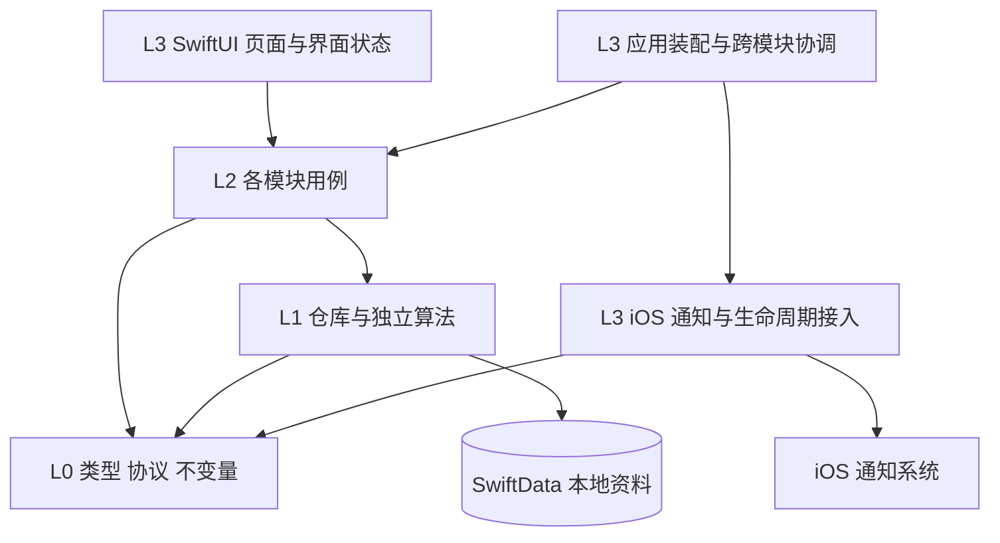

# 技术架构与数据设计

版本 0.2。更新：2026-10-15。用户已授权开发，本地个人版源码已实现；Swift 编译与真机尚未验证。云端仅保留契约。

## 1. 技术栈与构建边界

| 能力 | 选择 | 边界 |
|---|---|---|
| 界面 | SwiftUI、Observation、NavigationStack | View 不直接写数据库、不负责通知排程 |
| 语言 | Swift 6 语言模式 | 严格处理并发隔离，避免跨 actor 传递持久化对象 |
| 领域 | 普通 Swift 值类型与协议 | 不依赖 SwiftUI、SwiftData、UserNotifications |
| 存储 | SwiftData，本地 ModelContainer | 首版显式关闭 CloudKit 自动同步 |
| 调度 | UserNotifications | 提前提交请求；非后台常驻计时器 |
| 续排 | 启动、前台与本地资料变化 | 含今天的 3 个自然日，不实现后台刷新 |
| 时间 | Foundation Calendar + Date + IANA 时区标识 | 不把一天固定视为 86,400 秒 |
| 工程生成 | XcodeGen，版本与校验固定 | 仅构建工具，无 App 运行时依赖 |
| 云构建 | Codemagic macOS 或等效构建环境 | 只编译、测试和打包设备版未签名 IPA，不持有 Apple 凭据 |
| 本机安装 | Windows Sideloadly + 免费 Apple ID | 本机签名、安装和续签，先验证数据保留 |
| 测试 | 核心 XCTest、仓库 Swift Testing、XCTest UI | 已写测试，待 macOS 执行 |

最低部署目标建议 iOS 26.0。M0 根据手机实际系统与云镜像，锁定兼容的稳定版 Xcode/SDK、Swift、XcodeGen；不能把 `latest` 作为长期可复现配置。SwiftData 记录 Schema 版本；实际发生结构变化时才编写对应迁移，不预建多版本迁移框架。[Apple ModelContainer](https://developer.apple.com/documentation/swiftdata/modelcontainer)。

## 2. 四层依赖



L0 不依赖上层；L1 不依赖 L2/L3；不同模块的 L2 不能互相调用。跨模块操作由 L3 显式协调。下层通过 L0 协议接收依赖，不 import L3 实现。

SwiftData 仓库属于 L1 的存储能力；UserNotifications 的系统回调、路由和协议转换属于 L3。筛选候选、随机抽样、摘要排序等可复用纯算法留在 L1。

## 3. 当前目录

```text
应用/
  L0_公理层/
    事项类型.swift              # 领域值类型
    事项状态.swift
    时间规则.swift
    资料仓库协议.swift
    通知排程协议.swift         # 本地已用到的计划与投递接缝
    提醒模式.swift             # local/cloud 标识及能力查询
  L1_积木层/
    本地存储/                  # 持久化模型、仓库、迁移
    提醒算法/                  # 时间抽样、候选选择、摘要生成
    资料备份/                  # 编解码、校验、文件写入
  L2_流程层/
    记录模块/                  # 模块说明.md + 创建、补充、状态用例
    计划模块/                  # 模块说明.md + 进度、检查项、改期用例
    提醒模块/                  # 模块说明.md + 生成排程意图
  L3_外交层/
    界面/                      # 共用、琐事、计划、设置
    系统接入/                  # 本地通知、前台生命周期、深链
    跨模块流程/                # 事项变化协调、转计划、恢复协调
    应用装配.swift
资源/                          # Assets、字符串、隐私声明
测试/                          # 算法、流程、迁移、关键界面
构建/                          # 工具版本锁定与构建辅助脚本
project.yml                    # 工程事实来源
codemagic.yaml                 # 只验证与打包，不签名、不发布
```

中文用于目录、业务文件、文档与注释；Swift 内部标识符采用完整英文词，避免缩写与中英混写。系统要求的文件名、API、资源键、Scheme、Bundle ID 保留标准英文。产品显示名为“哦对了”，工程标识建议 `OhRight`。

首版一个 App target 加测试 target，按目录约束层次；不为了四层架构拆出大量二进制模块。未来有实际复用需求再提取 Swift Package。

## 4. 数据模型

实现决定：首版以一个 SwiftData StoredWorkspace 记录保存 Codable Workspace 完整快照，领域事项内嵌记录与检查项。一次显式 save 原子写入用户变更、版本与本地待协调状态，失败 rollback；不提前建立大量关系表。内部存储使用 Date 原始编码保留精度，外部 JSON 备份使用毫秒时间戳。大资料量下的整库编码性能待真机测量，后续需要时再迁移为分项记录。

以下为逻辑模型；持久化类单独置于 L1，不直接作为界面跨线程数据。

| 实体 | 关键字段 | 说明 |
|---|---|---|
| Item 事项 | id(UUID)、kind(idea/plan)、title、body、status、createdAt、updatedAt、revision | 同一实体原地转换类别 |
| 事项补充字段 | nextAction?、effortMinutes?、reminderEnabled、mutedUntil? | 下一步和估时可空 |
| 截止字段 | dueKind(dateOnly/instant)、dueLocalDate?、dueAt?、dueTimeZone? | 日期型与时刻型严格区分 |
| 生命周期字段 | completedAt?、archivedAt?、deletedAt?、previousStatus? | 可恢复，保留状态来源 |
| Entry 记录 | id、itemID、kind、text、createdAt、editedAt?、previousText? | kind 为补充、进度、状态变化等 |
| ChecklistStep 检查项 | id、itemID、text、position、isDone、completedAt? | 平铺列表，无嵌套子任务 |
| ReminderPreference 提醒偏好 | mode(local/cloud)、enabled、timePolicy、quietIntervals、ideaDailyLimit、digestLocalTime、contentPreview、soundEnabled | 当前 mode 仅 local 可用；timePolicy 为避开区间 / 全天随机 |
| DeadlineReminder 期限提醒 | id、itemID、requestedOffset、effectiveFireAt、enabled | 每计划首版至多一个，用户可选 |
| NotificationIntent 排程意图 | requestID、kind、itemIDs、fireAt、snapshotRevision、contentHash、state | 本地可重建派生数据，不是云同步消息队列 |
| NotificationAction 操作记录 | requestID、actionID、responseTime、handledAt? | 幂等处理通知操作 |
| ScheduleState 排程状态 | sourceRevision、appliedRevision、needsReconcile、coverageByKind、lastError? | 检测中途失败与覆盖范围 |
| Draft 草稿 | id、mode、text、formPayload、updatedAt | 与已保存事项分离 |
| LocalPreference 本机偏好 | appearance、lastMode、schemaVersion、installRandomSeed | 本地配置；备份按白名单导出 |

首版仅 `plan` 允许 `paused`；`active/completed/archived/deleted` 为共用状态。琐事的暂停提醒使用 mutedUntil，不把“没想完”当作错误或阻塞态。计划必须有一种截止表示；琐事不能携带生效的截止提醒。

时间线记录使用稳定 UUID 与父项关系。首次文本作为创建记录保留；改正文不覆盖补充历史。内容变更递增资料版本；通知观察和诊断更新不能伪装为用户取得进展。

## 5. 时间语义

- 创建、修改、进度时间存绝对时刻，展示按设备当前时区。
- “10 月 30 日结束”存本地年月日与创建时选择的时区；截止为该时区次日 00:00 的开区间边界，避免写死 23:59:59。
- 明确“10 月 30 日 18:00”存绝对时间与原时区，旅行后不偷偷改变真正截止时刻。
- 摘要时间与每日免打扰按设备当地墙钟时间解释。跨时区或显著时间变化时，在下一次可执行机会重排。
- 尚未得到执行机会时，已经提交的随机一次性通知仍按原定绝对时刻触发，不能承诺旅行后立刻遵循新当地免打扰时间。
- 夏令时跳过的摘要时刻取当天后一个有效时刻；重复时刻只发一次。用 Calendar 计算并加入专门测试。

## 6. 主要接口契约

| 接口 | 输入 → 输出 | 副作用与失败 |
|---|---|---|
| createIdea / createPlan | 创建命令 → ItemSnapshot | 原子保存事项、创建记录与资料版本 |
| appendEntry | itemID、文本、类型 → 新快照 | 父项不存在或已删除时拒绝写入 |
| changeLifecycle | itemID、目标状态、expectedRevision → 新快照 | 重复操作无重复历史；冲突重新读入 |
| convertIdeaToPlan | itemID、截止、下一步? → 新快照 | 保留 ID、记录；事务内校验新类别 |
| ReminderPlanner.makePlan | 资料快照、偏好、时钟、随机源、既有意图 → 期望请求集合 | 本地规则筛选与洗牌；纯计算，不写系统通知 |
| ReminderDelivery.replaceSchedule | 期望集合、版本与覆盖范围 → 排程报告 | 本地差量提交、回读；失败待下次启动修复 |
| CapabilityProvider / ModeCoordinator | 能力查询或目标模式 → 能力/切换结果 | 当前云端不可用；拒绝假切换并保留本地 |
| exportBackup / restoreBackup | 快照或文件 → 导出地址或恢复报告 | 版本、关系和完整性校验，恢复可回退 |

返回值是可安全传递的值类型。存储访问集中在一个串行写入入口，界面状态在 MainActor；排程协调使用单一 actor，避免两个重排任务交错。

## 7. 保存与通知的一致性

资料是唯一事实来源，通知队列是派生结果。不要要求数据库与 iOS 通知服务具有不存在的分布式事务。

1. L2 调用仓库提交业务变更。单次存储事务同时更新事项/记录、资料版本以及通用“待协调”标记。
2. 保存成功即可反馈“已保存”；L3 读取新快照，调用提醒模块计算期望通知。
3. 排程 actor 回读系统 pending requests，按稳定 ID 做增改删；完成/删除产生的失效通知优先移除。
4. 提交完成后回读验证，仅在资料版本仍相同时标记已协调；否则继续协调最新版本。
5. 中途崩溃或通知写入失败，不回滚已经保存的用户内容；下次启动根据待协调标记修复。

已经呈现的通知无法保证从用户记忆中撤回；完成后同时清理通知中心已知旧请求，点开任何旧通知都重新读取当前事项状态。

## 8. 数据可靠性、隐私与恢复

- 不依赖 SwiftData 隐式自动保存来表达“保存成功”；用户确认操作显式保存并处理错误。
- 使用系统文件保护；通知回调在数据库因锁定不可用时不做破坏性处理，等待用户打开后重试。M0/M3 真机检查重启后首次解锁情形。
- 默认不接第三方统计、广告或云内容分析。诊断日志只记录请求 ID、数量、时刻、版本、错误码，不写事项正文。
- 导出为有版本号的 JSON，包含事项、历史、检查项与提醒偏好；另提供人可读 Markdown 导出。文件由用户选择保存到“文件”，可放入自己的 iCloud Drive。
- 导出包含私人内容，在导出界面说明；用户未主动导出时，不上传资料到代码仓库或构建平台。当前没有任何业务云端连接。
- 首版恢复仅支持**整库替换**，先展示记录数量、备份日期与将替换范围，再由用户确认；不做容易冲突的合并导入。
- 恢复前生成本地安全快照，在临时容器验证文件版本、必填、UUID 唯一性与引用完整性；失败保留原库。完成后清理旧通知并从恢复数据重新排程。
- 通知 ID、系统授权状态、设备密钥和运行诊断不从备份恢复；UUID 和用户内容保持稳定。
- Schema 每次破坏性变化必须有迁移计划与旧数据夹具验证。迁移失败不得自动删库“修复”。

## 9. 后续扩展仅保留接缝

[云端接口与交接约定](云端接口与交接约定.md)统一说明排程、信息同步、推送、身份和模式切换的契约。现已实现本地代码使用到的协议及本地适配器；其余仅保留设计文档，不创建网络占位实现。

资料层保留本地需要的 UUID、revision 和备份版本即可。云端用户 ID、服务端版本、APNs token、同步游标、删除日志和网络 outbox 都在真正启用云端时再增加，不预建闲置表。

未来云端能力由应用装配注入；local/cloud 切换必须确认通知归属与远端停止结果，不能因网络失败直接重复发送。首版能力查询始终 cloudAvailable=false，不尝试登录、注册 APNs 或同步。

个人构建不加入 Push Notifications、CloudKit 或远端后台能力。未来上架通过独立 Distribution 构建配置接入，业务层不增加商店发布服务；签名团队或 Bundle ID 变化时通过已有导出契约迁移内容，不假设数据容器自动继承。

本地显式保存、备份恢复和单机排程协调继续保留，它们保护当前用户资料，与建设面向公众的云基础设施无关。
