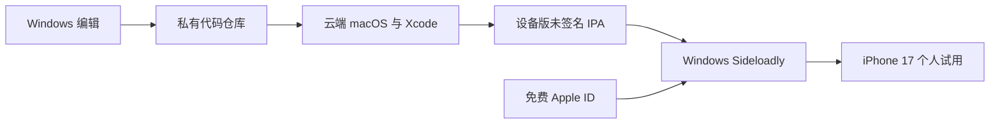

# 部署与维护方案

版本 0.2。更新：2026-10-15。目标：免费 Apple ID 自签名，先在自己的 iPhone 17 试用。构建脚本与云工作流已实现，尚未运行 macOS 构建或实际签名安装。

## 1. 构建与签名分离



云端仅编译，不配置 Apple Developer Program、App Store Connect、分发证书或 TestFlight。Apple ID 验证在用户本机签名工具里完成，不进入聊天、仓库或云构建环境。

默认签名工具选 Sideloadly，官网提供 Windows 版本、免费 Apple ID 安装与刷新能力。它是第三方工具；实际设备系统的兼容性必须在 M0 验证，不能只凭支持列表宣称已经装机。[Sideloadly 官网](https://sideloadly.io/)。

## 2. 免费的范围

| 项目 | 当前方案 |
|---|---|
| Apple 账号 | 免费 Apple ID / Apple Account，不购买开发者会员 |
| 编译工具 | Xcode 在云端 macOS 运行；Windows 无法替代 iOS 编译环境 |
| 云构建 | 优先现有免费额度；建议 Codemagic 仅作构建，服务可替换 |
| 本机签名 | Windows Sideloadly，首次 USB 安装 |
| 业务服务器 | 不部署、不付费 |
| 续签 | 免费个人配置通常 7 天有效；建议第 5–6 天刷新 |
| 运行数据 | 保存在手机；通过“文件”导出备份 |

Apple 对免费 Personal Team 记录了 7 天配置文件有效期、有限设备和同时安装数量限制。[Apple 账号说明](https://developer.apple.com/help/account/basics/about-your-developer-account)。Codemagic 免费额度与机型限制以账户及[当前价格页](https://codemagic.io/pricing/)为准；“免费 Apple ID”不等于云构建分钟永远免费。

## 3. 执行阶段的首次装机

1. 先准备单 App target 的最小工程，本地资料和通知之外不加入扩展或付费能力。
2. 选择兼容目标系统的稳定 Xcode 云镜像，锁定 XcodeGen 与工具版本。
3. 运行模拟器构建检查页面；另行生成 **iphoneos / arm64 的设备版**未签名 App。
4. 将设备版 App 按下节打包 IPA，连同 SHA-256、源码版本和构建信息下载到 Windows。
5. 从 Sideloadly 官网获取工具，按其当前 Windows 安装说明核对 Apple 设备驱动和 iTunes / iCloud 依赖；已有环境冲突时先确认影响，不盲目卸载现有软件。
6. USB 连接 iPhone，完成“信任此电脑”；在工具中选择设备、IPA 和免费 Apple ID，用户自行完成账号验证。
7. 按手机提示信任开发者；开发安装可能需要启用 Developer Mode 并重启。[Apple 开发者模式](https://developer.apple.com/documentation/xcode/enabling-developer-mode-on-a-device)。
8. 打开 App，建立测试事项，授权本地通知，安排两分钟后提醒；锁屏并退出 App 验证。
9. 用同一 IPA 和同一签名身份做一次覆盖续签，确认已有测试资料保留，记录最终有效 Bundle ID 和有效期。

工具要求和安装步骤以[Sideloadly 官方页面](https://sideloadly.io/)为准。若当前 iOS 与工具组合失败，先定位构建平台、开发者模式和签名错误；不把购买会员当作自动替代方案。

## 4. 未签名设备产物的构建契约

需要交付两个不同产物：

| 产物 | 平台 | 用途 |
|---|---|---|
| 模拟器 App 与测试报告 | iphonesimulator | 云端界面和逻辑验证，不能装真机 |
| 未签名设备 IPA | iphoneos / iOS / arm64 | 下载到 Windows 后签名安装 |

Apple Silicon 模拟器也可能是 arm64，因此仅检查 CPU 架构不够；必须检查 Mach-O 平台为 iOS，而非 iOS Simulator。使用 `xcrun vtool -show-build` 或等效检查记录平台信息。

执行阶段构建命令的意图如下，实际参数随锁定工具链验证：

```sh
xcodebuild build \
  -project OhRight.xcodeproj \
  -scheme OhRight \
  -configuration Release \
  -sdk iphoneos \
  -destination 'generic/platform=iOS' \
  -derivedDataPath build/device \
  CODE_SIGNING_ALLOWED=NO \
  CODE_SIGNING_REQUIRED=NO \
  CODE_SIGN_IDENTITY=""
```

将输出的 `Release-iphoneos/OhRight.app` 完整复制到暂存目录 `Payload/OhRight.app`，保留资源、内嵌框架与所需 Swift 库，再压缩为 IPA。不要把模拟器包改后缀，也不要走需要商店签名的 exportArchive 流程冒充未签名打包。未签名 IPA 必须经过本机签名才能运行。

上述设备打包是拟定工程步骤，M0 尚未实测；依据为 Xcode 的构建配置机制。Codemagic 的无签名模拟器示例只用于验证工作流，不可直接当作真机产物说明。[Apple 构建设置](https://developer.apple.com/documentation/xcode/configuring-the-build-settings-of-a-target/)、[Codemagic 模拟器构建](https://docs.codemagic.io/yaml-code-signing/ios-simulator-builds/)。

## 5. 个人试用构建配置

`PersonalTrial` 使用普通单 target、本地 SwiftData、本地通知；关闭 CloudKit、Push Notifications entitlement、remote-notification 后台模式、App Groups 和应用扩展。通知授权照常申请，本地通知不需要接 APNs。

云工作流仅保留：

- `verify`：编译、必要测试、界面截图。
- `package-personal`：生成设备版未签名 IPA、校验值与版本清单。

不提供 Apple 登录凭据、ASC API key 或签名私钥给 CI；不生成商店上传步骤。后续正式分发只在独立配置中添加能力，不污染个人配置。

## 6. 续签、更新与资料保留

每 5–6 天尝试续签，按实际配置有效期安排。未修改代码时重签现有 IPA 即可；只有更新功能才需要云端重新编译。

保持同一个 Apple ID 和签名工具产生的有效 Bundle ID。用户变更账号、工具重写标识或卸载 App 都可能影响容器连续性，M0 必须验证真实续签保留数据；更新和更换工具前先导出备份。

自动刷新只作可选便利：依赖电脑运行、配对和连接条件，不把它列为首版 App 的开发任务。过期打不开时重新签名安装；不要先删除 App。签名过期后的通知行为不作可靠性承诺。

**打开 App 补排、重新签名延长安装有效期、云端重新编译代码是三个独立动作。**

## 7. 故障处理与备用路径

| 情况 | 处理 |
|---|---|
| IPA 装不上 | 检查 iOS 设备平台、最低系统版本、有效标识、签名权限与 Developer Mode |
| 续签失败 | 检查账号验证、设备连接与实际有效期；保留现有 App 和备份 |
| App 能开但没有提醒 | 检查通知权限、免打扰、队列覆盖，重新打开补排 |
| 覆盖时间已过 | 打开 App 补齐未来 3 天即可 |
| 云额度用完 | 停止新构建，继续重签已有 IPA；不自动付费 |
| 更新后数据异常 | 保留库文件，优先修复或恢复备份，不自动清空资料 |

备用安装工具可考虑 AltStore Classic + AltServer 的 Windows 路线，但多一个手机端应用和配套流程，当前不同时维护两套工具；采用前重新核对其要求。[AltStore Windows 官方指南](https://faq.altstore.io/altstore-classic/how-to-install-altstore-windows)。

## 8. 暂缓的分发工作

开发者会员、ASC API、TestFlight、商店审核、发布流水线和公开用户运营均不实施。未来如启用，按[云端接口与交接约定](云端接口与交接约定.md)中构建配置边界接入。

本地 App 源码、project.yml、codemagic.yaml 和构建脚本已经写入；未连接云构建账号、生成实际 IPA、登录 Apple ID、安装签名工具、付费或发布。实际执行入口见[个人试用安装说明](个人试用安装说明.md)。
